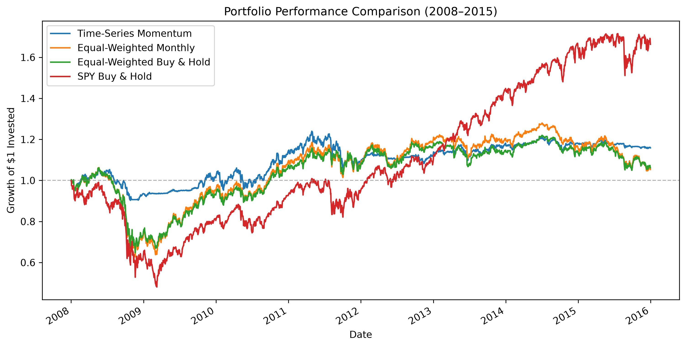
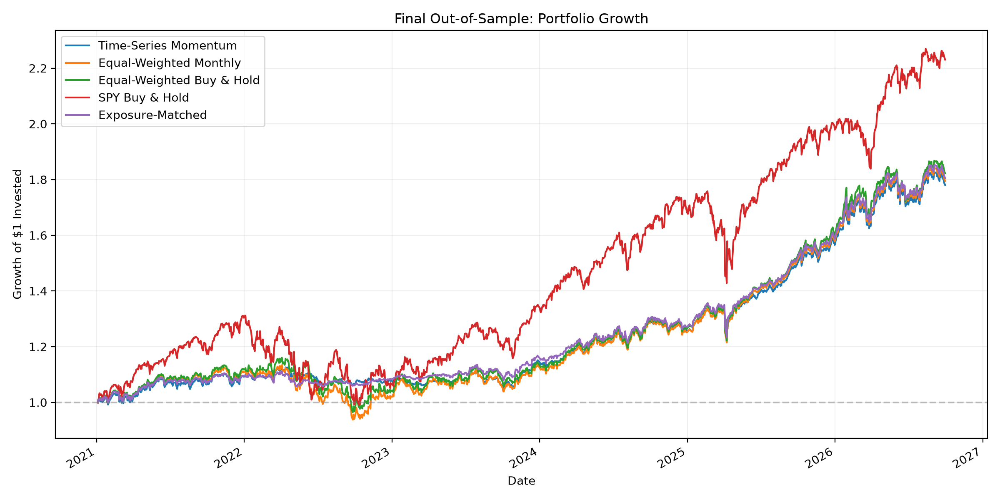
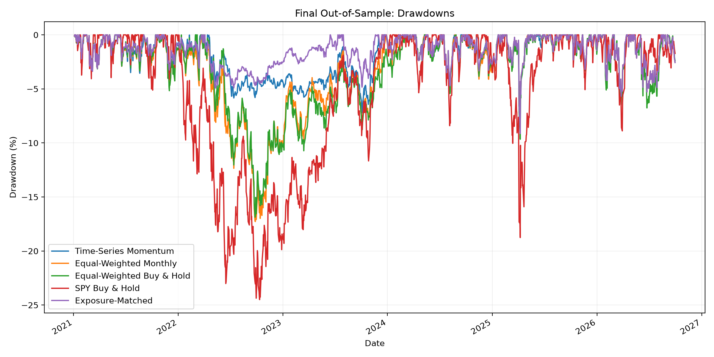
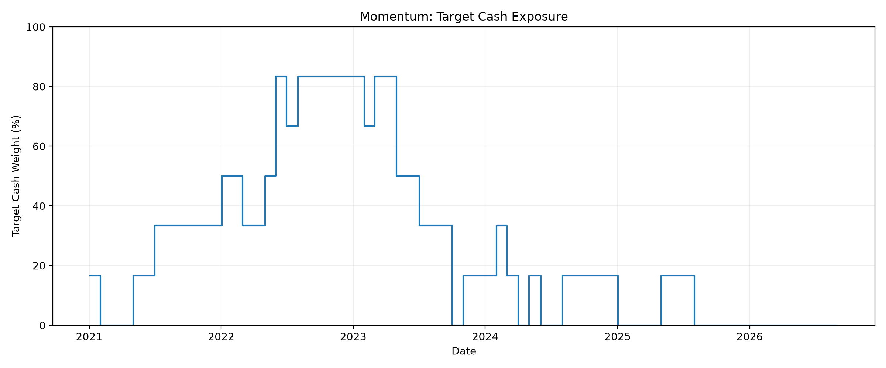

# Time-Series Momentum: Risk and Robustness Across Six ETFs

## Overview

This project investigates the risk-management properties of a 12-month Time-Series Momentum (TSMOM) strategy applied to a diversified portfolio of six exchange-traded funds (ETFs).

The central research question is:

**Can time-series momentum reduce portfolio downside risk and improve risk-adjusted performance relative to passive investment strategies?**

The study evaluates the strategy across three separate historical periods, with transaction costs, cash remuneration, reproducible backtesting and automated tests.

The emphasis is on understanding the sources and limitations of risk reduction rather than maximizing historical returns.

## Investment Universe

| ETF | Asset Class |
|---|---|
| SPY | US Equities |
| EFA | Developed International Equities |
| EEM | Emerging Market Equities |
| AGG | US Investment-Grade Bonds |
| GLD | Gold |
| DBC | Broad Commodities |

The universe was chosen retrospectively and is therefore subject to potential selection biases.

## Strategy Methodology

At the end of each month:

1. Calculate the trailing 12-month adjusted-price return of each ETF.
2. Assign a positive signal to ETFs with positive momentum.
3. Allocate 1/6 of total portfolio capital to each ETF with a positive signal.
4. Hold the remaining capital in cash.
5. Execute the target allocation at the following trading session's closing price.

The portfolio is rebalanced monthly.

### Trading and Cash Assumptions

- Initial portfolio capital: $10,000.
- Transaction costs: 0.10% of traded notional.
- Cash remuneration: Daily Federal Funds Effective Rate (DFF).
- Interest convention: ACT/360.
- Execution prices: Adjusted ETF closing prices.
- No leverage or short selling.
- No explicit modeling of bid-ask spreads, slippage, market impact or taxes.

DFF is used as a theoretical cash-return proxy and does not represent a guaranteed investable return.

## Research Design

The evaluation is divided into three periods:

| Period | Dates | Purpose |
|---|---|---|
| Development | 2008–2015 | Strategy investigation and exploratory analysis |
| Validation | 2016–2020 | Evaluation without changing strategy parameters |
| Final Out-of-Sample | 2021–September 2026 | Final assessment of the frozen strategy |

Each evaluation starts with $10,000 and no ETF positions.

Historical data preceding each period are used to construct the initial momentum signals.

The separate periods are not presented as one continuous portfolio track record.

### Primary Benchmarks

The strategy is compared against:

- Equal-Weighted Monthly: Six ETFs, rebalanced monthly.
- Equal-Weighted Buy & Hold: Equal initial allocation, without rebalancing.
- SPY Buy & Hold: Passive investment in SPY.

All benchmarks include the specified transaction-cost assumptions.

### Diagnostic Benchmarks

Additional exploratory comparisons include:

- Constant Exposure 60/40: 60% allocated equally across ETFs and 40% held in cash.
- Exposure-Matched: Matches Momentum's aggregate ETF exposure while allocating the invested fraction equally across all six ETFs.

Exposure-Matched is used to investigate the relative importance of aggregate exposure and individual ETF selection.

It is not an independent momentum signal or a causal decomposition.

## Key Results

### Time-Series Momentum Performance

| Metric | Development | Validation | Final OOS |
|---|---:|---:|---:|
| CAGR | 1.86% | 3.39% | 10.58% |
| Annualized Volatility | 8.81% | 7.09% | 8.95% |
| Maximum Drawdown | -14.51% | -15.75% | -9.14% |
| Sharpe Ratio | 0.214 | 0.342 | 0.799 |
| Calmar Ratio | 0.128 | 0.215 | 1.157 |

### Main Findings

**1. Consistent historical risk reduction**

Momentum exhibited lower realized volatility and smaller maximum drawdowns than the three fully invested primary benchmarks across all evaluation periods.

**2. Inconsistent risk-adjusted outperformance**

The strategy underperformed the primary benchmarks in Sharpe ratio during validation (2016–2020), but exceeded them during the final out-of-sample period.

Superior risk-adjusted performance was therefore not consistently observed.

**3. Aggregate exposure appears important**

Higher target cash allocations coincided with reduced losses during unfavorable market conditions, particularly in 2022.

The Exposure-Matched benchmark achieved higher CAGR and Sharpe ratios than Momentum during both validation and final evaluation.

This weakens the evidence that individual ETF selection consistently adds value beyond aggregate exposure management.

### Overall Interpretation

The findings are more consistent with time-series momentum acting as a historical defensive exposure-management mechanism than as a demonstrated source of persistent ETF-selection alpha.

These conclusions are descriptive and specific to the selected ETF universe, historical periods and modeling assumptions.

They do not establish statistical significance or guarantee future performance.

## Visualizations

### Development Period: Portfolio Growth



### Final Out-of-Sample: Portfolio Growth



### Final Out-of-Sample: Drawdowns



### Final Out-of-Sample: Target Cash Exposure



## Repository Structure

```text
quant-momentum-research/
├── backtest.py
├── README.md
├── requirements.txt
├── data/
│   ├── etf_prices.csv
│   └── dff_rates.csv
├── figures/
│   ├── portfolio_comparison.png
│   ├── final_equity_curves.png
│   ├── final_drawdowns.png
│   └── final_cash_exposure.png
├── research/
│   ├── development_analysis.py
│   ├── validation_analysis.py
│   ├── final_analysis.py
│   ├── development_findings.md
│   ├── validation_findings.md
│   ├── final_findings.md
│   ├── research_summary.md
│   ├── validation_protocol.md
│   └── results/
└── tests/
    └── test_backtest.py
```

The `research/results/` directory contains the CSV outputs generated by the research scripts.

## Reproducing the Results

### 1. Install Dependencies

From the project root:

```bash
python -m pip install -r requirements.txt
```

The project uses Python, NumPy, Pandas, Matplotlib and pytest.

### 2. Run Automated Tests

```bash
python -m pytest tests/test_backtest.py -v
```

The test suite covers transaction-cost accounting, signal timing, cash-interest calculations, data integrity and synthetic portfolio simulations.

### 3. Run the Backtest

```bash
python backtest.py
```

### 4. Reproduce the Research Periods

Development:

```bash
python -m research.development_analysis
```

Validation:

```bash
python -m research.validation_analysis
```

Final out-of-sample:

```bash
python -m research.final_analysis
```

These scripts use the locally stored ETF price and DFF datasets.

## Research Documentation

Detailed results and interpretation are available in:

- [Development Findings](research/development_findings.md)
- [Validation Findings](research/validation_findings.md)
- [Final Out-of-Sample Findings](research/final_findings.md)
- [Research Summary](research/research_summary.md)
- [Validation Protocol](research/validation_protocol.md)

## Limitations

Several limitations affect the interpretation of the results:

- Retrospective selection of the ETF universe.
- Theoretical DFF-based cash remuneration.
- Adjusted closing prices used as execution proxies.
- No explicit modeling of slippage or market impact.
- Different market exposure between Momentum and fully invested benchmarks.
- No formal statistical inference.
- Relatively short and heterogeneous evaluation periods.
- Reinitialized portfolios rather than one continuous investment history.
- Incomplete final calendar year (2026 ends in September).

These limitations prevent interpreting the results as evidence of a guaranteed investment advantage.

## Conclusion

Across the three evaluation periods, the 12-month Time-Series Momentum strategy consistently exhibited lower volatility and maximum drawdowns than the fully invested benchmarks.

However, its risk-adjusted performance advantage was not stable, and the Exposure-Matched comparisons did not establish a persistent incremental benefit from individual ETF selection.

The research suggests that dynamic exposure management may be an important driver of the strategy's defensive behavior, while leaving open questions about causality, statistical significance and practical implementation.
